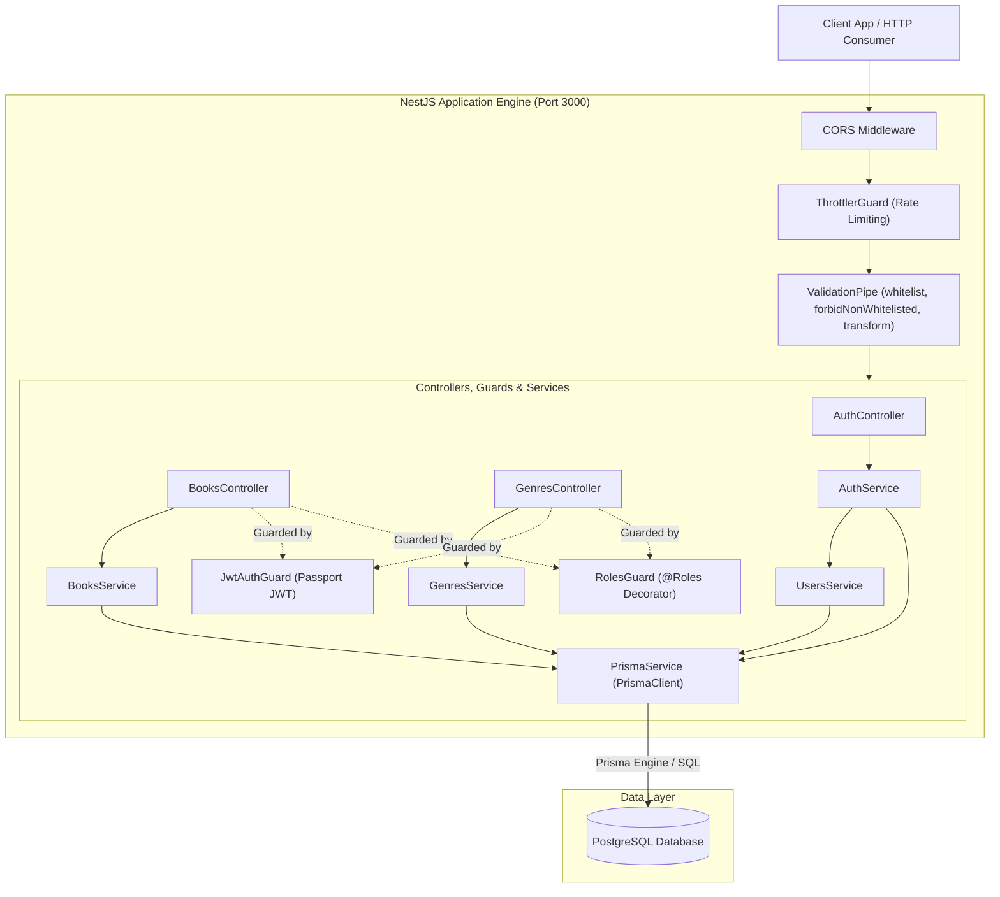
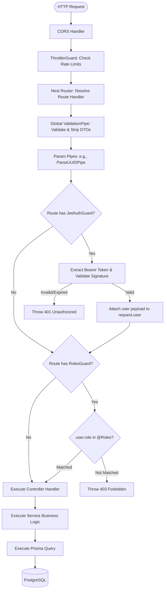
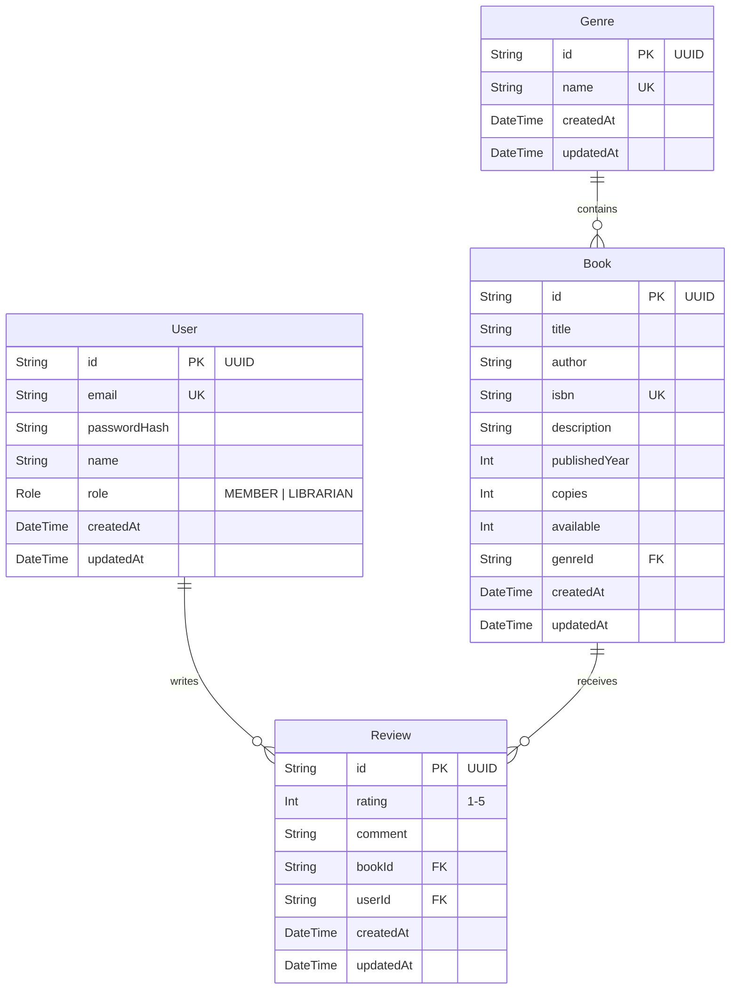

# API-Side Architecture

> Note: Also available in the project-wide documentation at [docs/api-architecture.md](file:///c:/Users/HomePC/Documents/PLP/MEARN/Week1/library%20management%20system/docs/api-architecture.md).

---

## 1. High-Level Modular Architecture

---

## 2. Request & Security Pipeline

---

## 3. Data Models & Entity Relations

