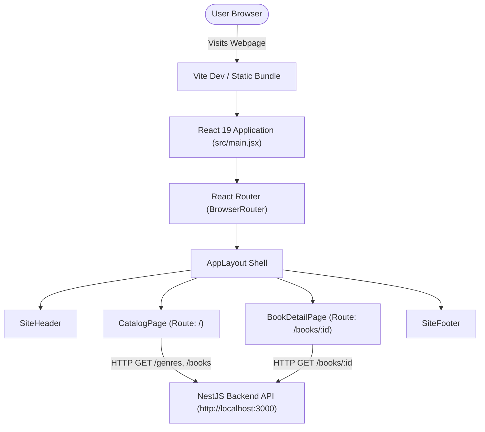
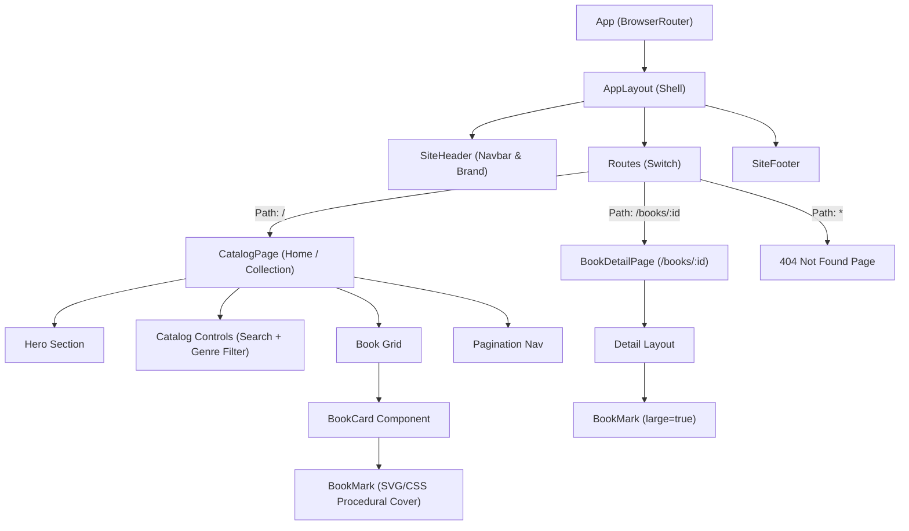
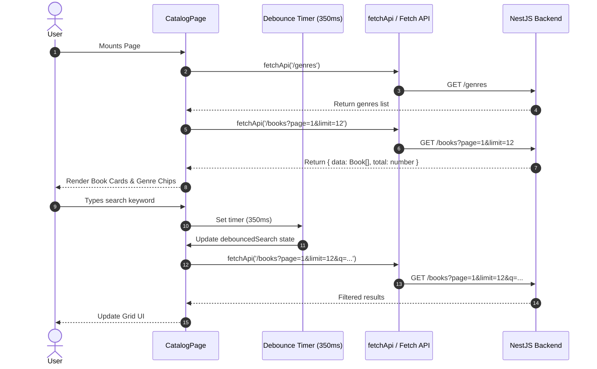

# Client-Side Architecture

> Note: Also available in the project-wide documentation at [docs/client-architecture.md](file:///c:/Users/HomePC/Documents/PLP/MEARN/Week1/library%20management%20system/docs/client-architecture.md).

---

## 1. High-Level Component Diagram

---

## 2. Component Hierarchy

---

## 3. Data & State Lifecycle

