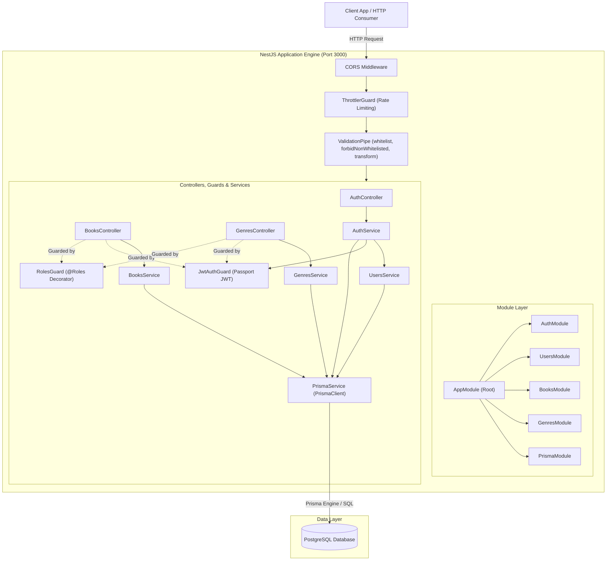
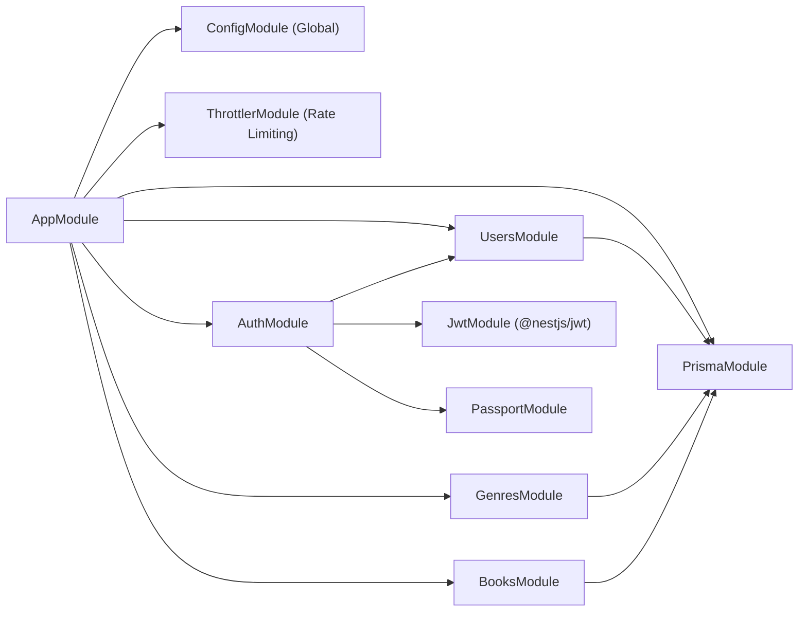
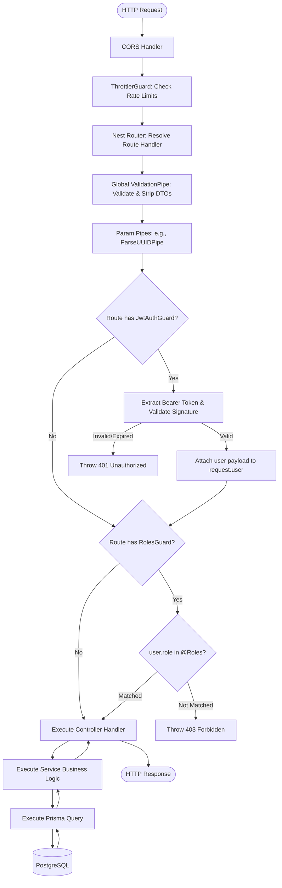
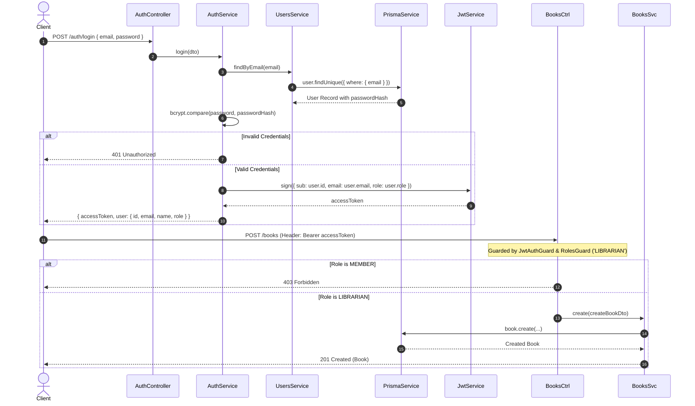
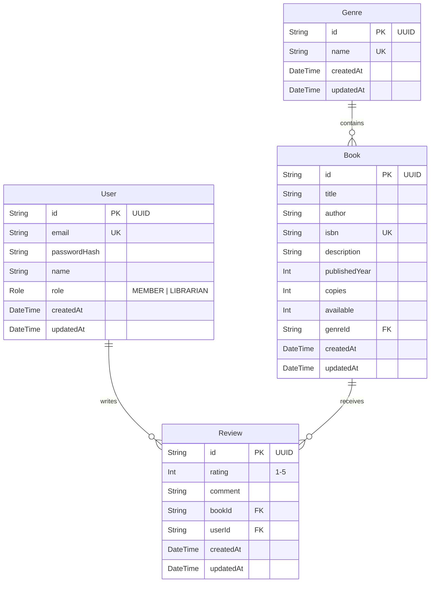

# API-Side Architecture Documentation

This document outlines the architecture, module relationships, authentication/authorization lifecycle, layered design, and data layer of the **Library Management System API**.

---

## 1. High-Level Architecture Overview

The API is built using **NestJS**, a progressive TypeScript framework, adopting modular architecture, dependency injection, and clean separation of concerns. Persistence is managed via **Prisma ORM** connecting to **PostgreSQL**.

---

## 2. NestJS Module Dependency Graph

---

## 3. Request-Response Pipeline

Every incoming HTTP request traverses an ordered pipeline before execution reaches domain services:

---

## 4. Authentication & Authorization Architecture

### 4.1 Token Issuance and Verification

- **Passwords**: Salted and hashed using `bcrypt`.
- **JWT**: Signed using `@nestjs/jwt` with a secret and expiry configured via `.env`.
- **RBAC**: Supports roles `MEMBER` and `LIBRARIAN`.
- **Protected Actions**: Administrative operations (Creating, updating, and deleting books or genres) strictly require `LIBRARIAN` role.

---

## 5. Database Schema & Entity Relationships

The schema is defined using Prisma schema specification connecting to PostgreSQL:

---

## 6. Endpoints Summary

| Method | Endpoint | Access | Guards | Description |
|---|---|---|---|---|
| `POST` | `/auth/register` | Public | Rate Limiter (10 req/min) | Registers a new member account |
| `POST` | `/auth/login` | Public | Rate Limiter (5 req/min) | Authenticates credentials and returns JWT |
| `GET` | `/auth/me` | Authenticated | `JwtAuthGuard` | Retrieves current authenticated profile |
| `GET` | `/books` | Public | None | Lists books with pagination (`page`, `limit`), search (`q`), and filter (`genreId`) |
| `GET` | `/books/:id` | Public | `ParseUUIDPipe` | Retrieves specific book with its genre relation |
| `POST` | `/books` | Librarian | `JwtAuthGuard`, `RolesGuard` (`LIBRARIAN`) | Creates a new book |
| `PATCH` | `/books/:id` | Librarian | `JwtAuthGuard`, `RolesGuard` (`LIBRARIAN`) | Updates existing book details |
| `DELETE` | `/books/:id` | Librarian | `JwtAuthGuard`, `RolesGuard` (`LIBRARIAN`) | Removes book from library |
| `GET` | `/genres` | Public | None | Lists all genres |
| `GET` | `/genres/:id` | Public | `ParseUUIDPipe` | Retrieves specific genre |
| `POST` | `/genres` | Librarian | `JwtAuthGuard`, `RolesGuard` (`LIBRARIAN`) | Creates a new genre |
| `PATCH` | `/genres/:id` | Librarian | `JwtAuthGuard`, `RolesGuard` (`LIBRARIAN`) | Updates an existing genre |
| `DELETE` | `/genres/:id` | Librarian | `JwtAuthGuard`, `RolesGuard` (`LIBRARIAN`) | Deletes a genre |
