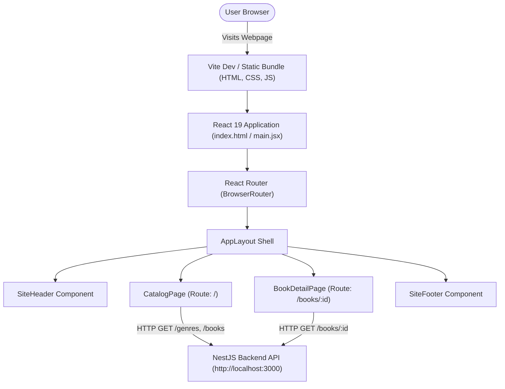
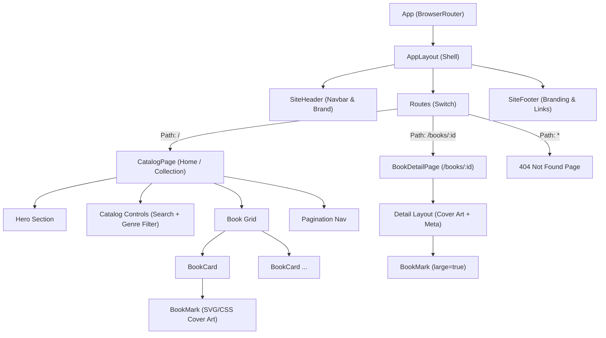
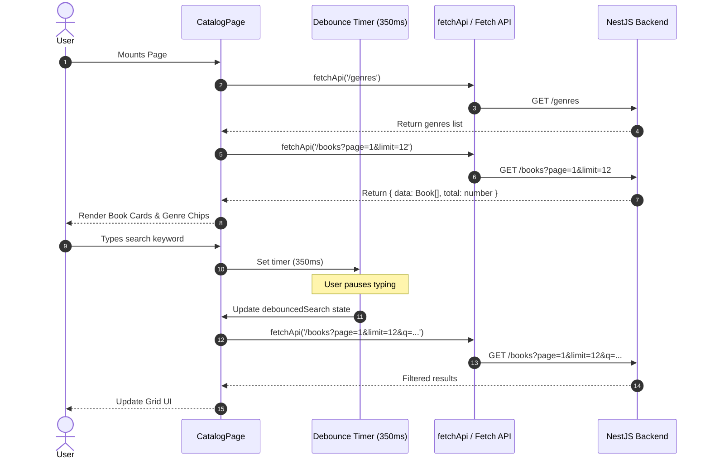
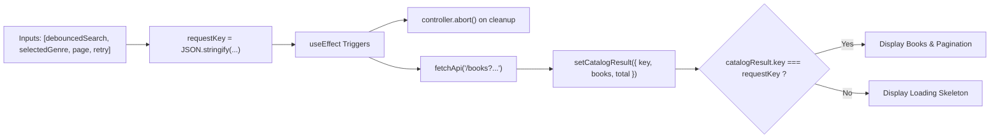

# Client-Side Architecture Documentation

This document outlines the architecture, component hierarchy, state lifecycle, routing, and data flow of the **Folio** Client application.

---

## 1. High-Level Overview

The client is a single-page application (SPA) built with **React 19**, **Vite**, and **React Router DOM v7**. It communicates over HTTP/REST with the NestJS backend API.

---

## 2. Component Hierarchy & Structure

---

## 3. Data Flow & State Management

The client utilizes React hooks (`useState`, `useEffect`) and standard web APIs (`fetch`, `AbortController`, `URLSearchParams`) for predictable, race-condition-free data fetching.

### 3.1 Catalog Page Flow

### 3.2 Request Lifecycle & Race Condition Guarding

To eliminate stale response overwrites during rapid user filtering, `CatalogPage` tracks a composite request key:

---

## 4. Key Client Subsystems

| Module | Purpose | Location |
|---|---|---|
| **Entry Point** | Mounts React root into `#root` DOM container | `src/main.jsx` |
| **Router & Root** | Provides `BrowserRouter` and high-level routing | `src/App.jsx` |
| **Catalog View** | Search, genre filtering, pagination, and book listing | `CatalogPage` in `src/App.jsx` |
| **Detail View** | Detailed metadata, availability status, ISBN, description | `BookDetailPage` in `src/App.jsx` |
| **Decorative Cover Art** | Dynamic procedural book cover generator | `BookMark` in `src/App.jsx` |
| **Networking** | Promise-based fetch wrapper with error handling | `fetchApi()` in `src/App.jsx` |
| **Design & Theme** | Typography, CSS custom properties, grid layouts | `src/App.css`, `src/index.css` |

---

## 5. Technology Stack

- **Framework**: React 19 (`react`, `react-dom`)
- **Routing**: React Router DOM v7 (`react-router-dom`)
- **Build Tool**: Vite 8 (`@vitejs/plugin-react`)
- **CSS Architecture**: Vanilla Modern CSS (CSS Grid, Flexbox, CSS Custom Variables, Container Queries)
