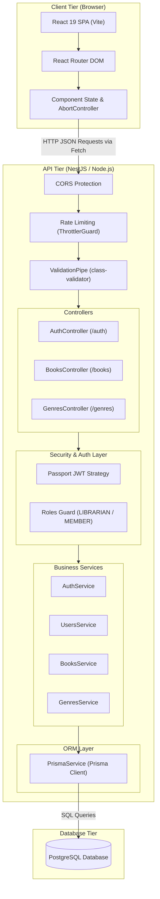

# System-Wide Architecture Documentation

This document provides a holistic end-to-end architecture view of the **Library Management System**, connecting the client-side SPA with the server-side NestJS REST API and PostgreSQL database.

---

## 1. Full-Stack System Diagram

---

## 2. Architecture Documentation Index

- [Client-Side Architecture Documentation](file:///c:/Users/HomePC/Documents/PLP/MEARN/Week1/library%20management%20system/docs/client-architecture.md)
- [API-Side Architecture Documentation](file:///c:/Users/HomePC/Documents/PLP/MEARN/Week1/library%20management%20system/docs/api-architecture.md)
